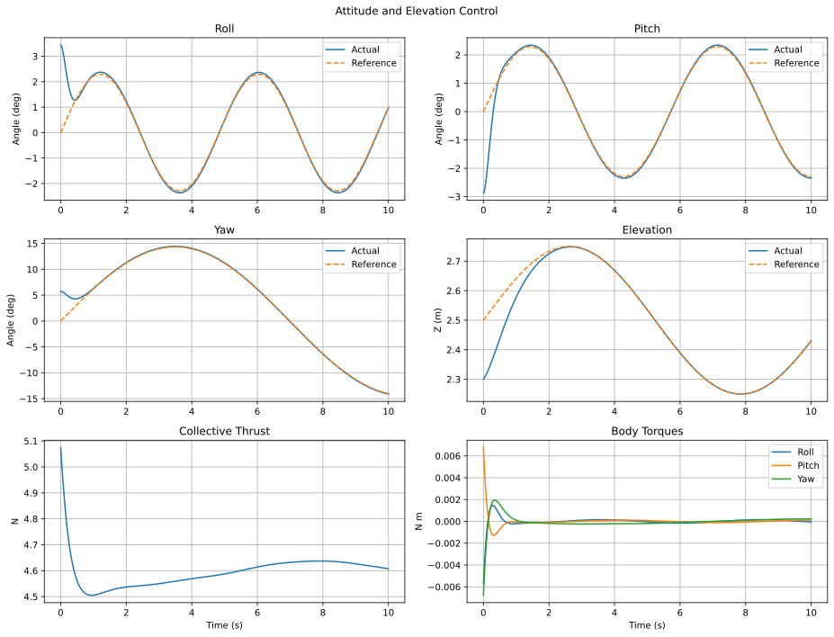
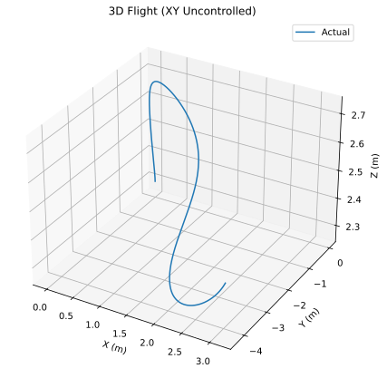
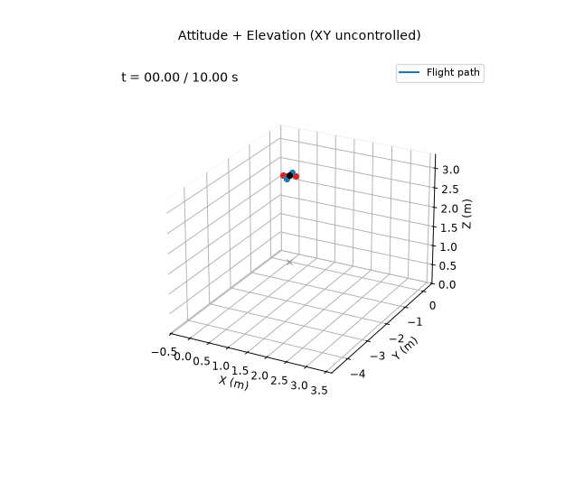

# Attitude + Elevation Controller

**Controlled variables:** roll $`\phi`$, pitch $`\theta`$, yaw $`\psi`$, and elevation $`z`$. Horizontal position is not regulated.

With $`\boldsymbol\eta=[\phi,\theta,\psi]^\top`$, the attitude PD law is

```math
\boldsymbol\tau = K_{P,\eta}\mathrm{wrap}(\boldsymbol\eta_d-\boldsymbol\eta)
+K_{D,\eta}(\dot{\boldsymbol\eta}_d-\dot{\boldsymbol\eta}).
```

Define the desired vertical acceleration

```math
a_z^*=\ddot z_d+k_{P,z}(z_d-z)+k_{D,z}(\dot z_d-\dot z).
```

The total thrust compensates gravity and the current roll/pitch inclination:

```math
T=\frac{m(g+a_z^*)}{\cos\phi\cos\theta}.
```

## Running

From this directory:

```bash
python main.py
```

This prints the metrics below and rewrites the files in `results/`.

## Results

Over the 10 s simulation:

| Metric | Value |
|---|---|
| Roll / pitch / yaw RMSE | 0.40° / 0.37° / 0.81° |
| Elevation RMSE | 0.046 m |

Horizontal position is not regulated, so the vehicle drifts in $`x`$ and $`y`$.






