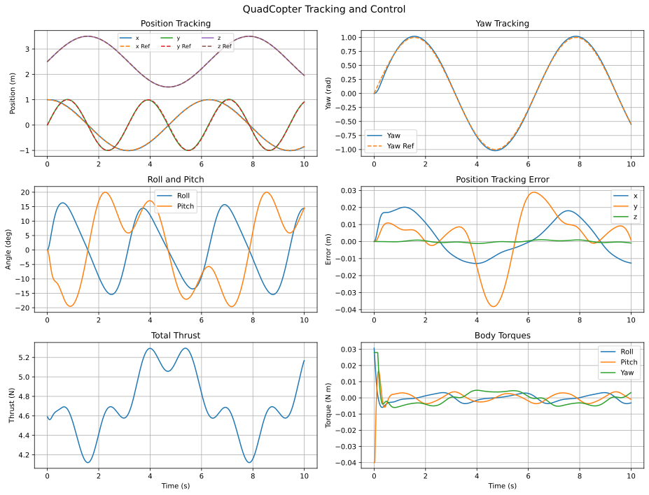
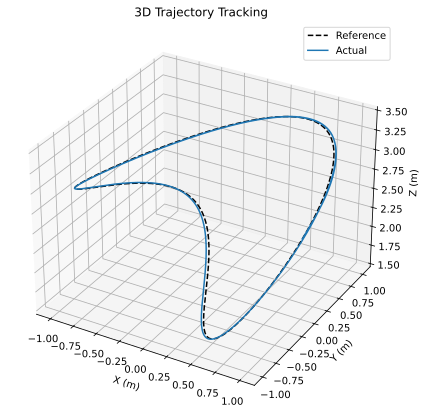
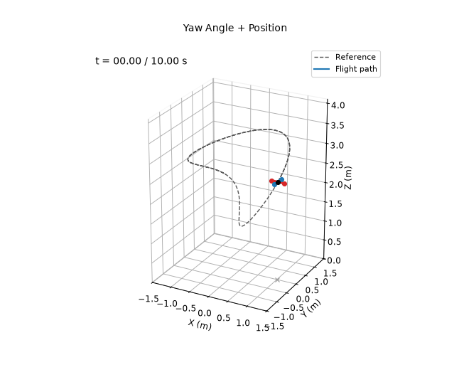

# Yaw Angle + Position Controller

**Controlled variables:** position $`\mathbf p=[x,y,z]^\top`$ and yaw $`\psi`$.

The outer-loop acceleration command is

```math
\mathbf a_c=\ddot{\mathbf p}_d+K_P(\mathbf p_d-\mathbf p)
+K_D(\dot{\mathbf p}_d-\dot{\mathbf p})
+K_I\int(\mathbf p_d-\mathbf p)\,dt.
```

Desired roll and pitch follow a small-angle horizontal inversion:

```math
\begin{aligned}
\phi_d&=\frac{\sin\psi_d\,a_{c,x}-\cos\psi_d\,a_{c,y}}{g},\\
\theta_d&=\frac{\cos\psi_d\,a_{c,x}+\sin\psi_d\,a_{c,y}}{g}.
\end{aligned}
```

The inner-loop attitude PD law includes desired angular-rate feedforward:

```math
\boldsymbol\tau=K_{P,\eta}(\boldsymbol\eta_d-\boldsymbol\eta)_{\mathrm{wrap}}
+K_{D,\eta}(\dot{\boldsymbol\eta}_d-\dot{\boldsymbol\eta}),\qquad
T=\frac{m(g+a_{c,z})}{\cos\phi\cos\theta}.
```

## Running

From this directory:

```bash
python main.py
```

This prints the metrics below and rewrites the files in `results/`.

## Results

Over the 10 s simulation:

| Metric | Value |
|---|---|
| Position RMSE ($`x`$, $`y`$, $`z`$) | 0.011, 0.016, 0.001 m |
| Total position RMSE | 0.019 m |
| Yaw RMSE | 0.022 rad |






