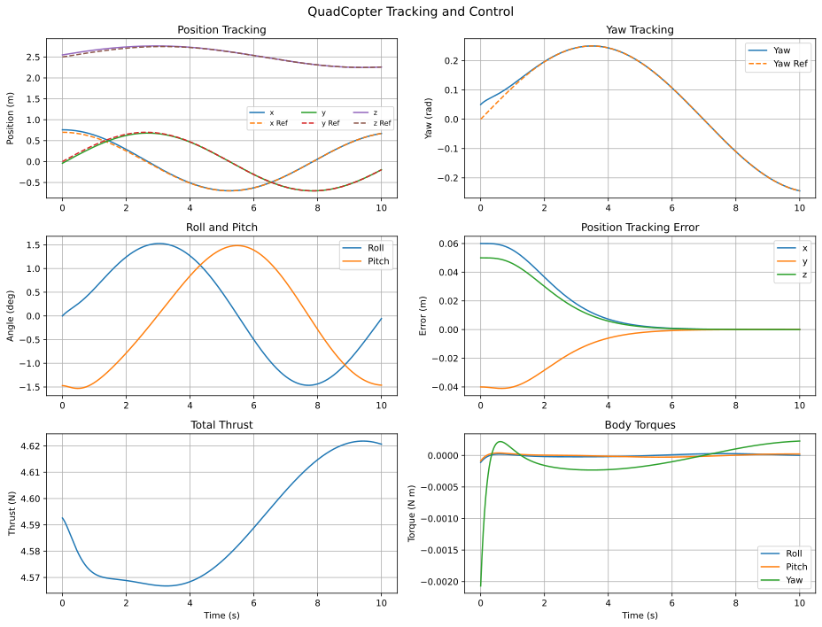
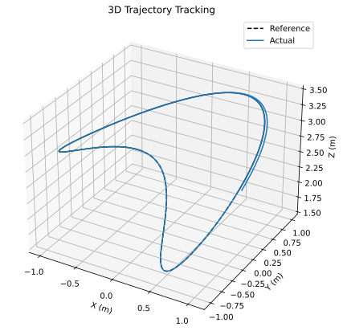
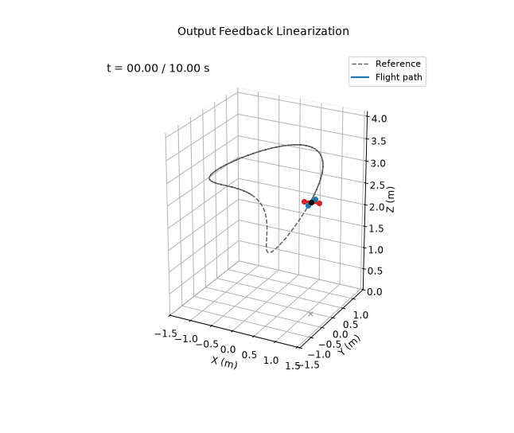

# Output Feedback Control with Feedback Linearization

**Controlled outputs:** $`\mathbf y=[x,y,z,\psi]^\top`$.

Introduce the dynamic thrust extension $`\dot T=s`$ and $`\dot s=u_T`$. The position and yaw input-output dynamics satisfy

```math
\begin{bmatrix}\mathbf p^{(4)}\\\ddot\psi\end{bmatrix}
=\mathbf b(X)+A(X)\begin{bmatrix}u_T\\\boldsymbol\tau\end{bmatrix}.
```

The virtual inputs are

```math
\begin{aligned}
\mathbf v_p={}&\mathbf p_d^{(4)}+K_3(\mathbf p_d^{(3)}-\mathbf p^{(3)})
+K_2(\ddot{\mathbf p}_d-\ddot{\mathbf p})\\
&+K_1(\dot{\mathbf p}_d-\dot{\mathbf p})+K_0(\mathbf p_d-\mathbf p),\\
v_\psi={}&\ddot\psi_d+k_{D,\psi}(\dot\psi_d-\dot\psi)
+k_{P,\psi}\mathrm{wrap}(\psi_d-\psi).
\end{aligned}
```

Thus, for invertible $`A(X)`$,

```math
\begin{bmatrix}u_T\\\boldsymbol\tau\end{bmatrix}
=A(X)^{-1}\!\left(\begin{bmatrix}\mathbf v_p\\v_\psi\end{bmatrix}-\mathbf b(X)\right).
```

The selected characteristic polynomials are $`(s+4)^4`$ for position and $`(s+4)^2`$ for yaw. Output derivatives are reconstructed from the full state and model. The reference is the figure-8 shared by demos 2 and 4–9, with its derivatives up to snap.

## Running

From this directory:

```bash
python main.py
```

This prints the metrics below and rewrites the files in `results/`.

## Results

Over the 10 s simulation:

| Metric | Value |
|---|---|
| Position RMSE ($`x`$, $`y`$, $`z`$) | 0.016, 0.011, 0.013 m |
| Total position RMSE | 0.024 m |
| Yaw RMSE | 0.009 rad |

The run starts 9 cm off the reference. With the true state and an exact model the linearization is exact, so the error decays with the chosen poles and stays below 0.6 mm after 3 s. The RMSE comes almost entirely from that initial transient.






