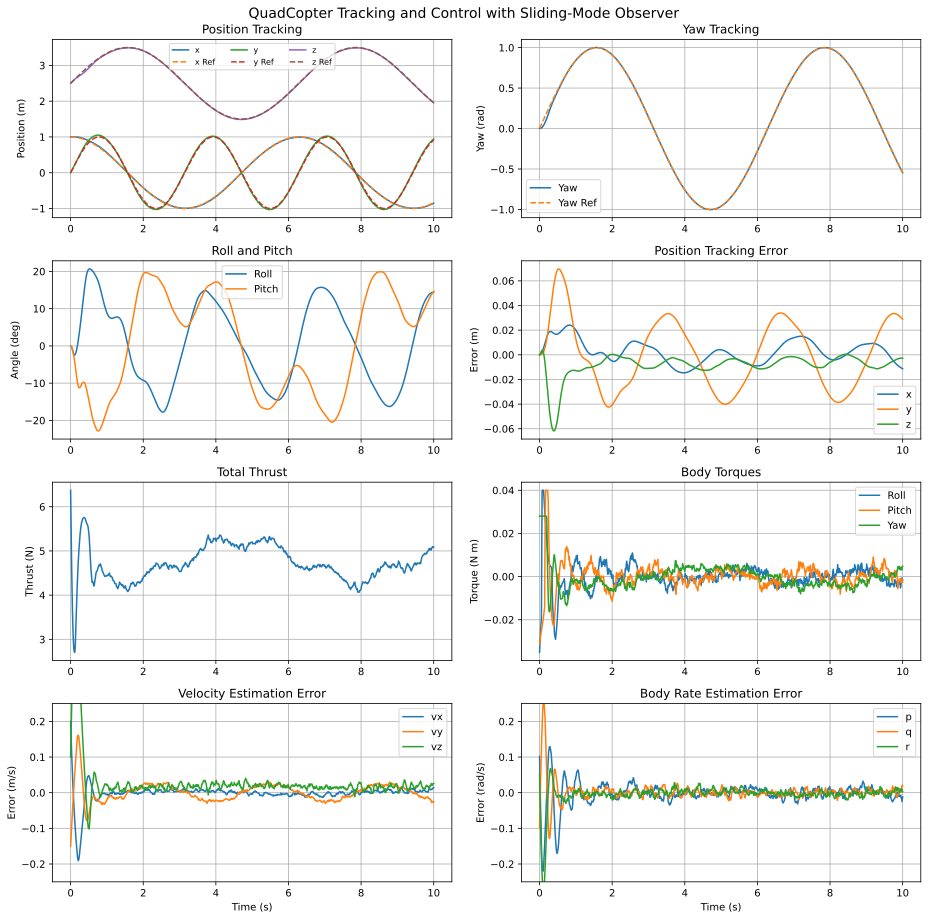
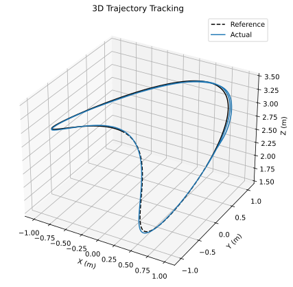
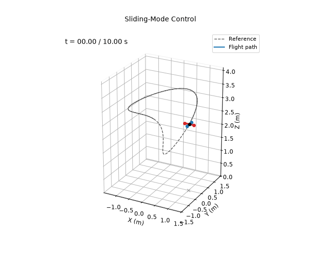

# Sliding-Mode Controller + Observer

**Controlled variables:** position $`\mathbf p`$ and yaw $`\psi`$, through cascaded translational and attitude sliding surfaces.

**Measured outputs:** position $`\mathbf p`$ and Euler angles $`\boldsymbol\eta`$ only, with sensor noise. The controller never sees the true state: velocities and body rates come from a sliding-mode observer.

For $`\mathbf e_p=\mathbf p_d-\mathbf p`$ and $`\mathbf e_v=\dot{\mathbf p}_d-\dot{\mathbf p}`$,

```math
\mathbf s_p=\mathbf e_v+\Lambda_p\mathbf e_p,\qquad
\mathbf a_c=\ddot{\mathbf p}_d+\Lambda_p\mathbf e_v
+K_p\mathrm{sat}(\mathbf s_p/\boldsymbol\epsilon_p).
```

The desired attitude and thrust are obtained from $`m(\mathbf a_c+g\mathbf e_3)`$ and the desired yaw. Let $`\mathbf e_\eta=(\boldsymbol\eta_d-\boldsymbol\eta)_{\mathrm{wrap}}`$ and $`\mathbf e_{\dot\eta}=\dot{\boldsymbol\eta}_d-\dot{\boldsymbol\eta}`$. Then

```math
\mathbf s_\eta=\mathbf e_{\dot\eta}+\Lambda_\eta\mathbf e_\eta,\qquad
\ddot{\boldsymbol\eta}_c=\ddot{\boldsymbol\eta}_d
+\Lambda_\eta\mathbf e_{\dot\eta}
+K_\eta\mathrm{sat}(\mathbf s_\eta/\boldsymbol\epsilon_\eta).
```

The commanded moments compensate rigid-body rotational coupling:

```math
\boldsymbol\tau=\mathbf I\left(E(\boldsymbol\eta)\ddot{\boldsymbol\eta}_c
+\dot E(\boldsymbol\eta,\dot{\boldsymbol\eta})\dot{\boldsymbol\eta}\right)
+\boldsymbol\omega\times(\mathbf I\boldsymbol\omega).
```

In the laws above, every state is the observer estimate.

## Sliding-Mode Observer

Let $`\mathbf q=[\mathbf p^\top,\boldsymbol\eta^\top]^\top`$ be the measured coordinates and $`\mathbf y=\mathbf q+\mathbf n`$ the noisy measurement. With output error $`\tilde{\mathbf y}=\mathbf y-\hat{\mathbf q}`$ (angles wrapped), the observer is

```math
\begin{aligned}
\dot{\hat{\mathbf q}}&=\hat{\dot{\mathbf q}}+A_1\tilde{\mathbf y}+K_1\mathrm{sat}(\tilde{\mathbf y}/\boldsymbol\Phi),\\
\dot{\hat{\dot{\mathbf q}}}&=\hat f(\hat{\mathbf q},\hat{\dot{\mathbf q}},\mathbf u)+A_2\tilde{\mathbf y}+K_2\mathrm{sat}(\tilde{\mathbf y}/\boldsymbol\Phi),
\end{aligned}
```

where $`\hat f`$ is the rigid-body model built from nominal parameters $`\hat m=0.440`$ kg and $`\hat{\mathbf I}=\mathrm{diag}(0.0021,0.0025,0.0042)`$ kg m², which are 6–9% off the true values. The switching gains $`K_2`$ have to dominate this model error. Body rates are recovered from $`\hat{\boldsymbol\omega}=E(\hat{\boldsymbol\eta})\hat{\dot{\boldsymbol\eta}}`$. The observer runs at 200 Hz.

Sensor noise has a standard deviation of 1 mm on position and 0.1° on each angle. The observer starts with deliberate errors of up to 10 cm, 3°, 0.2 m/s and 0.1 rad/s.

| Channel | $`A_1`$ | $`A_2`$ | $`K_1`$ | $`K_2`$ | $`\Phi`$ |
|---|---|---|---|---|---|
| $`x`$, $`y`$ | 10 | 25 | 0.01 | 1 | 5 mm |
| $`z`$ | 10 | 25 | 0.01 | 2 | 5 mm |
| $`\phi`$, $`\theta`$, $`\psi`$ | 10 | 100 | 0.01 | 1 | 5 mrad |

The observer and controller gains were tuned together by grid search. The search minimized position and yaw error while penalizing torque chattering, and the chosen gains were checked on five noise seeds.

## Running

From this directory:

```bash
python main.py
```

This prints the metrics below and rewrites the files in `results/`.

## Results

Over the 10 s simulation:

| Metric | Value |
|---|---|
| Position RMSE ($`x`$, $`y`$, $`z`$) | 0.009, 0.028, 0.013 m |
| Total position RMSE | 0.032 m |
| Yaw RMSE | 0.011 rad |
| Observer velocity RMSE ($`t\ge1`$ s) | 0.006, 0.017, 0.018 m/s |
| Observer body rate RMSE ($`t\ge1`$ s) | 0.014, 0.009, 0.008 rad/s |






