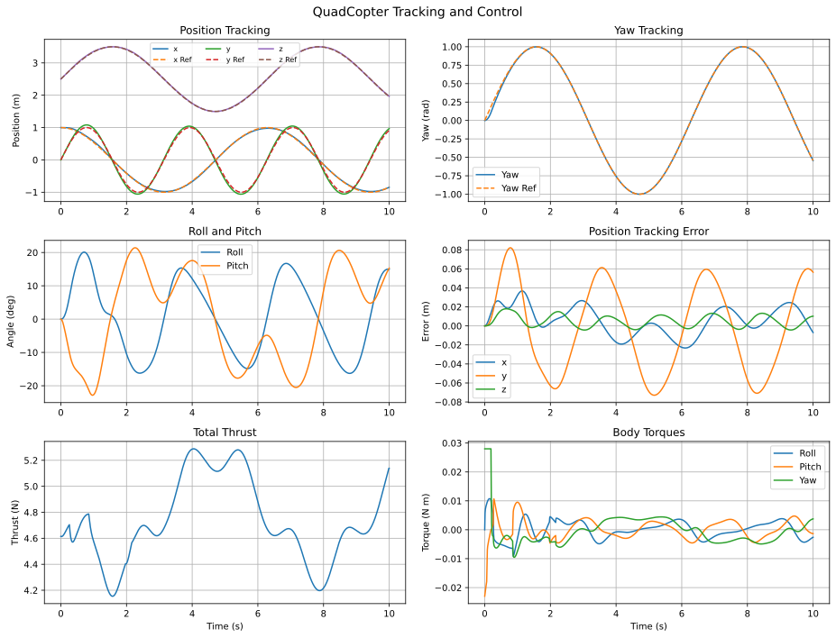
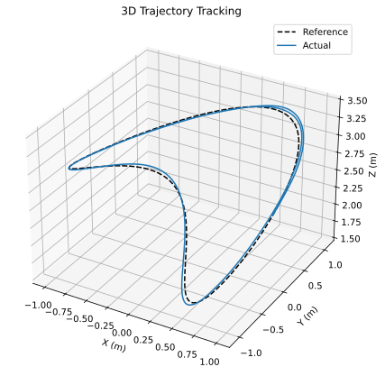
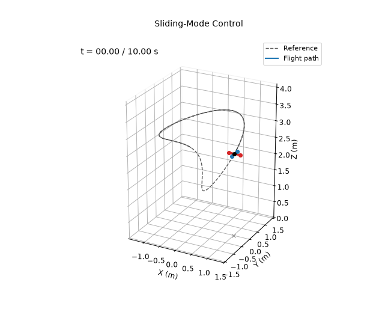

# Sliding-Mode Controller

**Controlled variables:** position $\mathbf p$ and yaw $\psi$, through cascaded translational and attitude sliding surfaces.

For $\mathbf e_p=\mathbf p_d-\mathbf p$ and $\mathbf e_v=\dot{\mathbf p}_d-\dot{\mathbf p}$,

$$
\mathbf s_p=\mathbf e_v+\Lambda_p\mathbf e_p,\qquad
\mathbf a_c=\ddot{\mathbf p}_d+\Lambda_p\mathbf e_v
+K_p\operatorname{sat}(\mathbf s_p/\boldsymbol\epsilon_p).
$$

The desired attitude and thrust are obtained from $m(\mathbf a_c+g\mathbf e_3)$ and the desired yaw. Let $\mathbf e_\eta=(\boldsymbol\eta_d-\boldsymbol\eta)_{\mathrm{wrap}}$ and $\mathbf e_{\dot\eta}=\dot{\boldsymbol\eta}_d-\dot{\boldsymbol\eta}$. Then

$$
\mathbf s_\eta=\mathbf e_{\dot\eta}+\Lambda_\eta\mathbf e_\eta,\qquad
\ddot{\boldsymbol\eta}_c=\ddot{\boldsymbol\eta}_d
+\Lambda_\eta\mathbf e_{\dot\eta}
+K_\eta\operatorname{sat}(\mathbf s_\eta/\boldsymbol\epsilon_\eta).
$$

The commanded moments compensate rigid-body rotational coupling:

$$
\boldsymbol\tau=\mathbf I\left(E(\boldsymbol\eta)\ddot{\boldsymbol\eta}_c
+\dot E(\boldsymbol\eta,\dot{\boldsymbol\eta})\dot{\boldsymbol\eta}\right)
+\boldsymbol\omega\times(\mathbf I\boldsymbol\omega).
$$

## Running

From this directory:

```bash
python main.py
```

This prints the metrics below and rewrites the files in `results/`.

## Results

Over the 10 s simulation:

| Metric | Value |
|---|---|
| Position RMSE ($x$, $y$, $z$) | 0.016, 0.047, 0.008 m |
| Total position RMSE | 0.050 m |
| Yaw RMSE | 0.014 rad |






