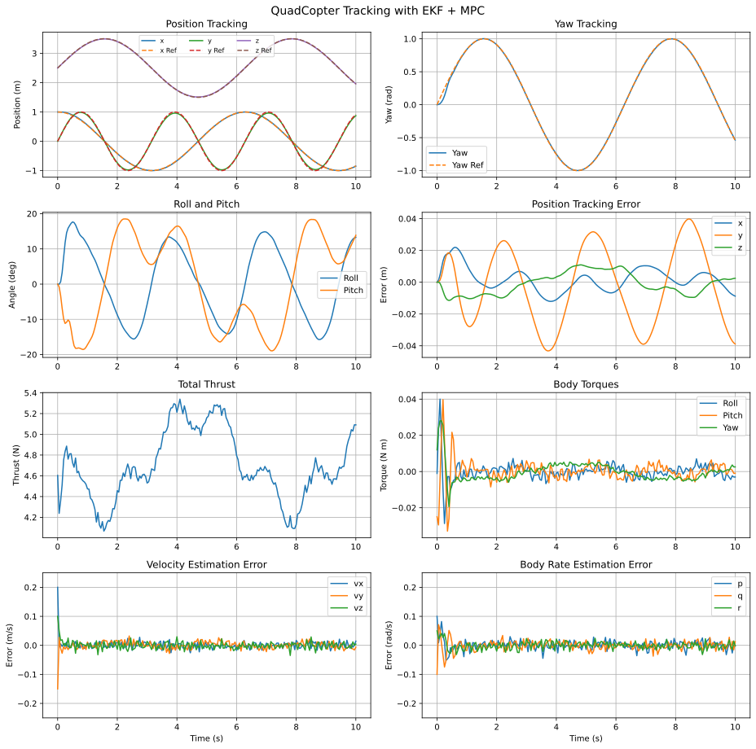
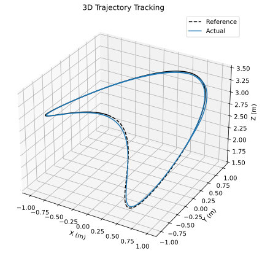
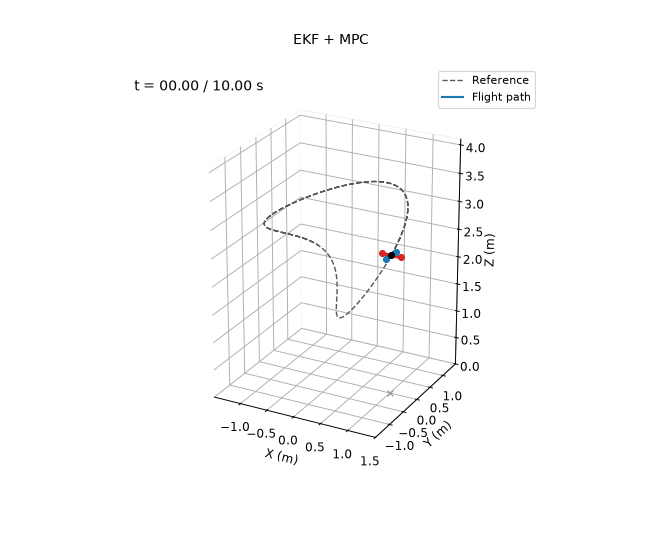

# EKF + MPC

**Controlled variables:** the 12-state quadcopter model, through constrained offset-free model predictive control.

**Measured outputs:** position $`\mathbf p`$ and Euler angles $`\boldsymbol\eta`$ only, with sensor noise. An extended Kalman filter estimates the full state together with a constant acceleration disturbance, and the MPC predicts with the nominal model plus that disturbance.

The nominal model uses $`\hat m=0.440`$ kg and $`\hat{\mathbf I}=\mathrm{diag}(0.0021,0.0025,0.0042)`$ kg m², which are 6–9% off the true values. Sensors, noise, initial estimation errors and trajectory are the same as in demos 4 and 6–9. This is the conventional counterpart of demo 6: the same MPC, with a disturbance estimate in place of the neural network.

## Prediction Model

The disturbance $`\mathbf d`$ acts on the translational dynamics, which is where the mass error appears:

```math
\dot{\mathbf x}=f_{\mathrm{nom}}(\mathbf x,\mathbf u)+\begin{bmatrix}\mathbf 0\\\mathbf d\\\mathbf 0\\\mathbf 0\end{bmatrix},\qquad
\dot{\mathbf d}=\mathbf w_d .
```

Without $`\mathbf d`$, the wrong mass leaves a steady vertical offset, because the MPC hovers with the thrust the nominal model asks for. Estimating it is the standard way to make MPC offset-free.

## Extended Kalman Filter

The EKF runs at 200 Hz on the 15-state model $`[\mathbf x^\top,\mathbf d^\top]^\top`$. Each step corrects with the measurement $`\mathbf y=H\mathbf x+\mathbf n`$ (angle innovations wrapped), using the Joseph form, and then predicts one step with RK4. The random-walk density on $`\mathbf d`$ sets how fast the disturbance estimate follows changes. The other process noise densities are the same as in demo 7.

## Constrained MPC

Every 50 ms the prediction model is linearized at the current estimate and the last input, with the current disturbance estimate included, and discretized. The controller then minimizes, over a horizon of $`N=20`$ steps (1 s),

```math
J=\sum_{k=1}^{N}\|\mathbf x_k-\mathbf x_{d,k}\|_Q^2
+\sum_{k=0}^{N-1}\!\left(\|\mathbf u_k-\mathbf u_{\mathrm{hover}}\|_R^2
+\|\Delta\mathbf u_k\|_S^2\right)
+\|\mathbf x_N-\mathbf x_{d,N}\|_P^2,
```

subject to actuator limits, input-rate limits, and constraints on altitude, velocity, roll and pitch, and body rates. The QP is solved by the same ADMM solver as in demo 6, warm-started from the shifted previous solution.

The disturbance noise and the MPC weights were tuned by grid search. The search minimized position and yaw error while penalizing thrust and torque chattering, and the chosen values were checked on five noise seeds. The final values are a disturbance noise density of 0.1, position weights of 240, 240 and 440, a yaw weight of 200, and input-rate weights $`S=\mathrm{diag}(6,80,80,60)`$.

## Running

From this directory:

```bash
python main.py
```

This prints the metrics below and rewrites the files in `results/`.

## Results

Over the 10 s simulation:

| Metric | Value |
|---|---|
| Position RMSE ($`x`$, $`y`$, $`z`$) | 0.008, 0.024, 0.007 m |
| Total position RMSE | 0.026 m |
| Total position RMSE without the disturbance estimate | 0.058 m |
| Yaw RMSE | 0.019 rad |
| Estimated vertical disturbance at the end | −0.61 m/s² (true model error −0.65 m/s²) |
| EKF velocity RMSE ($`t\ge1`$ s) | 0.010, 0.011, 0.011 m/s |

The disturbance estimate also removes the bias in the vertical velocity estimate seen in demos 7–9. Here it does better than the neural network of demo 6, because the model error is mostly the constant effect of the wrong mass, which is exactly what a constant disturbance models. The network can represent errors that depend on the state, but it has to learn them first.






