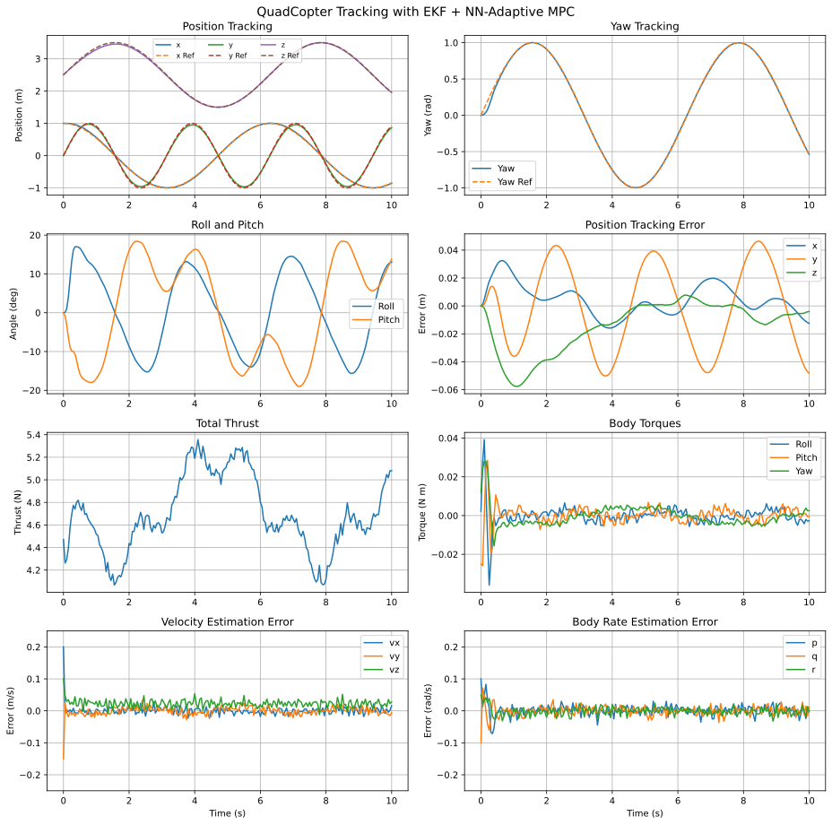
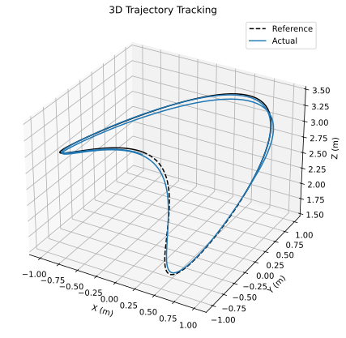
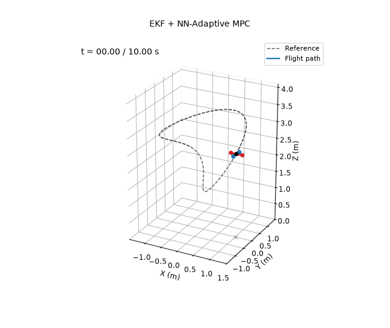

# EKF + NN-Adaptive MPC

**Controlled variables:** the 12-state quadcopter model, through constrained model predictive control whose prediction model is corrected online by a neural network.

**Measured outputs:** position $`\mathbf p`$ and Euler angles $`\boldsymbol\eta`$ only, with sensor noise. An extended Kalman filter estimates the full state, the neural network learns the model error from the filter's corrections, and the MPC predicts with the corrected model.

The nominal model uses $`\hat m=0.440`$ kg and $`\hat{\mathbf I}=\mathrm{diag}(0.0021,0.0025,0.0042)`$ kg m², which are 6–9% off the true values. Sensors, noise, initial estimation errors and trajectory are the same as in demos 4, 6 and 7.

## NN-Corrected Prediction Model

The nominal model is corrected by a nonlinear-in-parameter neural network:

```math
\dot{\mathbf x}=f_{\mathrm{nom}}(\mathbf x,\mathbf u)+W\,\sigma(V^\top\bar{\mathbf x}),\qquad
\sigma(\cdot)=\tanh(\cdot),\qquad
\bar{\mathbf x}=D^{-1}\begin{bmatrix}\mathbf x\\\mathbf u\end{bmatrix},
```

with 24 hidden neurons and input scaling $`D`$. The EKF and the MPC both use this corrected model, so learning improves the state estimate and the prediction together.

## Extended Kalman Filter and Learning

The EKF runs at 200 Hz. Each step corrects with the measurement $`\mathbf y=H\mathbf x+\mathbf n`$ (angle innovations wrapped), using the Joseph form, and then predicts one step with the NN-corrected model:

```math
\hat{\mathbf x}^+=\hat{\mathbf x}^-+L(\mathbf y-H\hat{\mathbf x}^-),\qquad
\hat{\mathbf x}^-_{k+1}=\mathrm{RK4}(f_{\mathrm{nom}}+W\sigma,\ \hat{\mathbf x}^+_k,\ \mathbf u_k).
```

Once the filter is tracking, the correction $`\hat{\mathbf x}^+_{k+1}-\hat{\mathbf x}^-_{k+1}`$ is the part of the last step's motion that the prediction model missed. Divided by $`\Delta t`$, it estimates the remaining model error $`\mathbf e`$. The network learns from it, never from the true plant model, with regularized gradient updates evaluated at the previous state and input:

```math
\dot W=\eta_1\,\mathbf e\,\boldsymbol\sigma^\top-\rho_1 W,\qquad
\dot V=\eta_2\,\bar{\mathbf x}\left[(W^\top\mathbf e)\odot(1-\boldsymbol\sigma^{2})\right]^\top-\rho_2 V.
```

Learning starts 0.5 s into the run, after the filter has recovered from its initial error.

## Constrained MPC

Every 50 ms the corrected model is linearized at the current estimate and the last input, and discretized. The controller then minimizes, over a horizon of $`N=20`$ steps (1 s),

```math
J=\sum_{k=1}^{N}\|\mathbf x_k-\mathbf x_{d,k}\|_Q^2
+\sum_{k=0}^{N-1}\!\left(\|\mathbf u_k-\mathbf u_{\mathrm{hover}}\|_R^2
+\|\Delta\mathbf u_k\|_S^2\right)
+\|\mathbf x_N-\mathbf x_{d,N}\|_P^2,
```

subject to actuator limits, input-rate limits, and constraints on altitude, velocity, roll and pitch, and body rates. The QP is solved by an ADMM solver written for this demo, warm-started from the shifted previous solution.

The NN learning rates and the MPC weights were tuned by grid search. The search minimized position and yaw error while penalizing thrust and torque chattering, and the chosen values were checked on five noise seeds. The final values are $`\eta_1=10`$, $`\eta_2=0.5`$ and $`\rho_1=0.03`$, $`\rho_2=0.02`$, a yaw state weight of 200, and input-rate weights $`S=\mathrm{diag}(6,80,80,60)`$. The EKF process noise is the same as in demo 6.

`report.pdf` documents the original version of this design, in which a neural-network observer replaced the EKF.

## Running

From this directory:

```bash
python main.py
```

This prints the metrics below and rewrites the files in `results/`.

## Results

Over the 10 s simulation:

| Metric | Value |
|---|---|
| Position RMSE ($`x`$, $`y`$, $`z`$) | 0.012, 0.030, 0.023 m |
| Total position RMSE | 0.040 m |
| Total position RMSE with learning turned off | 0.069 m |
| Yaw RMSE | 0.019 rad |
| Model error explained by the NN ($`t\ge5`$ s) | 55% |
| EKF velocity RMSE ($`t\ge1`$ s) | 0.010, 0.011, 0.025 m/s |

The vertical error caused by the mass mismatch is about 6 cm at first and is learned away within about 5 s.






