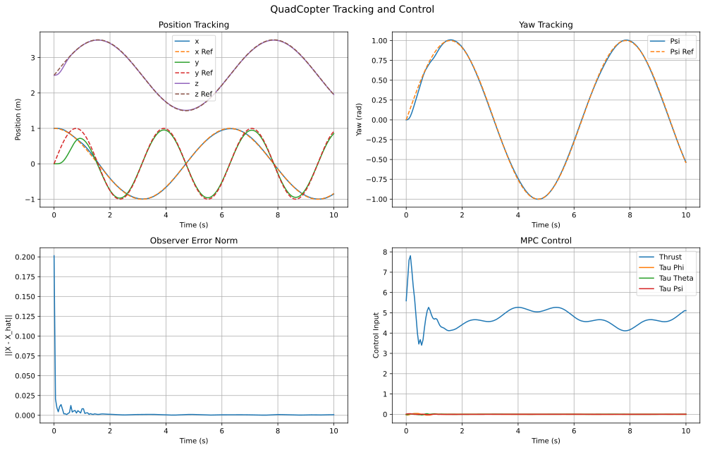
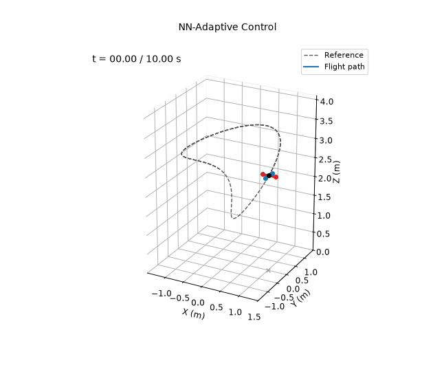

# NN-Adaptive MPC

**Controlled variables:** the 12-state quadcopter model with online neural-network model-error adaptation and constrained predictive control.

The nominal model is corrected by a neural approximation:

$$
\dot{\mathbf x}=f_{\mathrm{nom}}(\mathbf x,\mathbf u)+W\,\sigma(V^\top\bar{\mathbf x}),\qquad
\sigma(\cdot)=\tanh(\cdot),\qquad
\bar{\mathbf x}=D^{-1}\begin{bmatrix}\mathbf x\\\mathbf u\end{bmatrix}.
$$

The observer is

$$
\dot{\hat{\mathbf x}}=f_{\mathrm{nom}}(\hat{\mathbf x},\mathbf u)
+W\sigma(V^\top D^{-1}[\hat{\mathbf x}^\top,\mathbf u^\top]^\top)
+G(\mathbf x-\hat{\mathbf x}).
$$

The $N=20$ horizon controller minimizes

$$
J=\sum_{k=1}^{N}\|\mathbf x_k-\mathbf x_{d,k}\|_Q^2
+\sum_{k=0}^{N-1}\!\left(\|\mathbf u_k-\mathbf u_{\mathrm{hover}}\|_R^2
+\|\Delta\mathbf u_k\|_S^2\right)
+\|\mathbf x_N-\mathbf x_{d,N}\|_P^2,
$$

subject to state, input, and input-rate constraints.

The neural weights learn only from the observer error $\tilde{\mathbf x}=\mathbf x-\hat{\mathbf x}$, not from the true plant model. Once the estimation error settles, $\dot{\tilde{\mathbf x}}\approx 0$, and the part of the dynamics the model does not explain is estimated by $\mathbf e=G\tilde{\mathbf x}$. With $\boldsymbol\sigma=\tanh(V^\top\bar{\mathbf x})$ evaluated at $\hat{\mathbf x}$, the regularized gradient updates are

$$
\dot W=\eta_1\,\mathbf e\,\boldsymbol\sigma^\top-\rho_1 W,\qquad
\dot V=\eta_2\,\bar{\mathbf x}\left[(W^\top\mathbf e)\odot(1-\boldsymbol\sigma^{2})\right]^\top-\rho_2 V.
$$

## Running

From this directory:

```bash
python main.py
```

This prints the metrics below and rewrites the files in `results/`.

## Results

Measured from $t=2$ s to the end of the 10 s simulation:

| Metric | Value |
|---|---|
| Position RMSE ($x$, $y$, $z$) | 0.008, 0.033, 0.007 m |
| Total position RMSE | 0.035 m |
| Yaw RMSE | 0.010 rad |
| Observer RMSE (after 0.2 s) | 0.0006 |

With learning turned off, the total position RMSE rises to 0.049 m and the observer RMSE to 0.003. Learning from the observer error does as well as learning from the true model residual (0.035 m).




