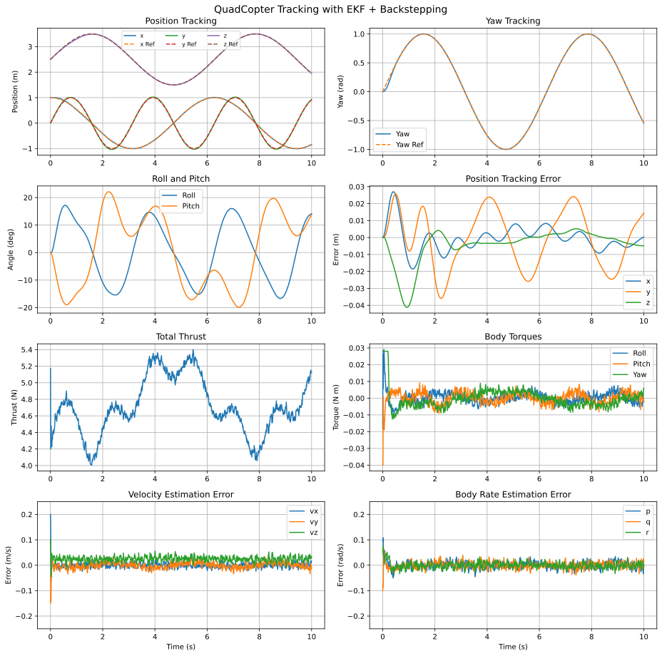
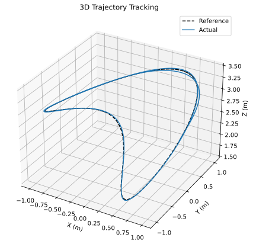
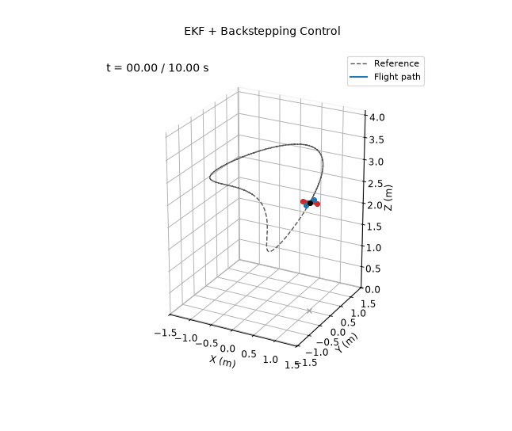

# EKF + Backstepping

**Controlled variables:** position $`\mathbf p`$ and yaw $`\psi`$, through cascaded integral backstepping on the translational and attitude dynamics.

**Measured outputs:** position $`\mathbf p`$ and Euler angles $`\boldsymbol\eta`$ only, with sensor noise. The controller acts on the estimate from the same extended Kalman filter as demo 6.

The EKF and the controller both use nominal parameters $`\hat m=0.440`$ kg and $`\hat{\mathbf I}=\mathrm{diag}(0.0021,0.0025,0.0042)`$ kg m², which are 6–9% off the true values. Sensors, noise, initial estimation errors and trajectory are the same as in demos 4 and 6.

## Position Backstepping

With $`\mathbf e_1=\mathbf p_d-\hat{\mathbf p}`$ and its integral $`\boldsymbol\chi_1`$, the virtual velocity and its error are

```math
\mathbf v_d=\dot{\mathbf p}_d+C_1\mathbf e_1+\Lambda_1\boldsymbol\chi_1,\qquad
\mathbf e_2=\mathbf v_d-\hat{\mathbf v}.
```

The Lyapunov function $`V=\tfrac12\|\mathbf e_1\|^2+\tfrac12\boldsymbol\chi_1^\top\Lambda_1\boldsymbol\chi_1+\tfrac12\|\mathbf e_2\|^2`$ decreases, with $`\dot V=-\mathbf e_1^\top C_1\mathbf e_1-\mathbf e_2^\top C_2\mathbf e_2`$, for the commanded acceleration

```math
\mathbf a_c=\ddot{\mathbf p}_d+C_1(\dot{\mathbf p}_d-\hat{\mathbf v})+(I+\Lambda_1)\mathbf e_1+C_2\mathbf e_2.
```

The thrust $`T=\hat m\|\mathbf a_c+g\mathbf e_3\|`$ and the desired roll and pitch follow from the direction of $`\mathbf a_c+g\mathbf e_3`$ and the reference yaw, with tilt limited to 30°.

## Attitude Backstepping

The same structure is used on the Euler angles. The flatness-based reference rates $`\dot{\boldsymbol\eta}_r`$ and accelerations $`\ddot{\boldsymbol\eta}_r`$ act as feedforward, and integral action is used on yaw only. With $`\mathbf e_3=(\boldsymbol\eta_d-\hat{\boldsymbol\eta})_{\mathrm{wrap}}`$ and its integral $`\boldsymbol\chi_3`$,

```math
\begin{aligned}
\mathbf e_4&=\dot{\boldsymbol\eta}_r+C_3\mathbf e_3+\Lambda_3\boldsymbol\chi_3-\dot{\hat{\boldsymbol\eta}},\\
\ddot{\boldsymbol\eta}_c&=\ddot{\boldsymbol\eta}_r+C_3(\dot{\boldsymbol\eta}_r-\dot{\hat{\boldsymbol\eta}})+(I+\Lambda_3)\mathbf e_3+C_4\mathbf e_4,\\
\boldsymbol\tau&=\hat{\mathbf I}\left(E(\hat{\boldsymbol\eta})\ddot{\boldsymbol\eta}_c+\dot E\,\dot{\hat{\boldsymbol\eta}}\right)+\hat{\boldsymbol\omega}\times(\hat{\mathbf I}\hat{\boldsymbol\omega}).
\end{aligned}
```

Integrals are clipped to ±0.5.

| Gain | $`C_1`$ | $`C_2`$ | $`\Lambda_1`$ | $`C_3`$ | $`C_4`$ | $`\Lambda_3`$ |
|---|---|---|---|---|---|---|
| $`x`$, $`y`$, $`z`$ | 3 | 4 | 5 | | | |
| $`\phi`$, $`\theta`$ | | | | 10 | 10 | 0 |
| $`\psi`$ | | | | 10 | 15 | 0.5 |

The EKF is the one from demo 6. It runs at 200 Hz on noisy position and Euler angle measurements (1 mm and 0.1° standard deviation), with process noise densities of $`10^{-4}`$ on position and angles and 0.1 on velocity and body rates. It starts with errors of up to 10 cm, 3°, 0.2 m/s and 0.1 rad/s.

The backstepping gains were tuned by grid search. The search minimized position and yaw error while penalizing thrust and torque chattering, and the chosen gains were checked on five noise seeds.

## Running

From this directory:

```bash
python main.py
```

This prints the metrics below and rewrites the files in `results/`.

## Results

Over the 10 s simulation:

| Metric | Value |
|---|---|
| Position RMSE ($`x`$, $`y`$, $`z`$) | 0.008, 0.017, 0.011 m |
| Total position RMSE | 0.021 m |
| Yaw RMSE | 0.012 rad |
| EKF velocity RMSE ($`t\ge1`$ s) | 0.010, 0.012, 0.027 m/s |
| EKF body rate RMSE ($`t\ge1`$ s) | 0.012, 0.013, 0.011 rad/s |






