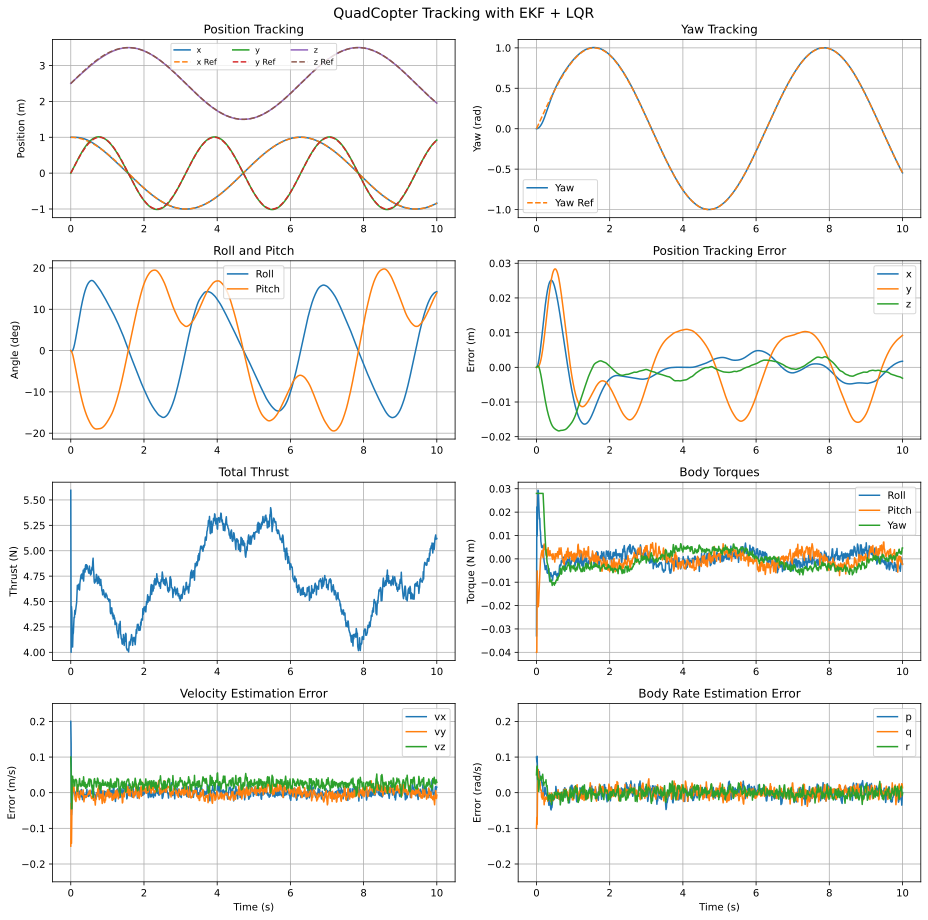
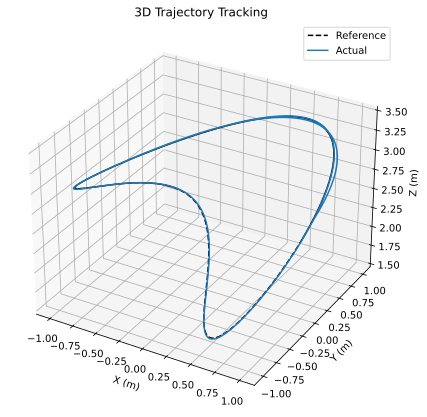
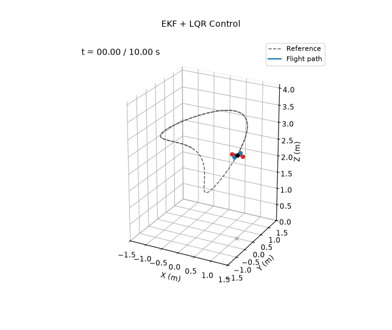

# EKF + LQR

**Controlled variables:** position $`\mathbf p`$ and yaw $`\psi`$, with a time-varying LQR around a flatness-based reference.

**Measured outputs:** position $`\mathbf p`$ and Euler angles $`\boldsymbol\eta`$ only, with sensor noise. The controller never sees the true state: it acts on the estimate from an extended Kalman filter.

The EKF and the LQR design both use nominal parameters $`\hat m=0.440`$ kg and $`\hat{\mathbf I}=\mathrm{diag}(0.0021,0.0025,0.0042)`$ kg m², which are 6–9% off the true values. Sensors, noise, initial estimation errors and trajectory are the same as in demos 4–6, so the observer-based designs can be compared directly.

## Reference and Feedforward

The flat outputs $`\mathbf p_d(t)`$ and $`\psi_d(t)`$ fix the rest of the reference. The thrust direction follows from $`\mathbf F=\ddot{\mathbf p}_d+g\mathbf e_3`$, which gives $`\phi_d`$ and $`\theta_d`$ for the desired yaw. The rates and torques come from

```math
\boldsymbol\omega_d=E(\boldsymbol\eta_d)\dot{\boldsymbol\eta}_d,\qquad
T_d=\hat m\|\mathbf F\|,\qquad
\boldsymbol\tau_d=\hat{\mathbf I}\dot{\boldsymbol\omega}_d+\boldsymbol\omega_d\times(\hat{\mathbf I}\boldsymbol\omega_d),
```

which gives the reference state $`\mathbf x_d(t)`$ and input $`\mathbf u_d(t)`$. The derivatives of the closed-form attitude map are taken by central differences.

## Time-Varying LQR

The nominal model is discretized over the 10 ms control step and linearized along the reference, $`\delta\mathbf x_{k+1}=A_k\delta\mathbf x_k+B_k\delta\mathbf u_k`$. The state is augmented with the integrals $`\boldsymbol\chi`$ of the $`x`$, $`y`$, $`z`$ and $`\psi`$ errors, which remove the offset caused by the wrong mass. A backward Riccati recursion over the whole trajectory gives the gain schedule offline:

```math
K_k=(R+B_k^\top P_{k+1}B_k)^{-1}B_k^\top P_{k+1}A_k,\qquad
P_k=Q+A_k^\top P_{k+1}(A_k-B_kK_k).
```

The terminal cost is the stationary Riccati solution at the final point. The control law is

```math
\mathbf u_k=\mathbf u_{d,k}-K_k\begin{bmatrix}\hat{\mathbf x}_k-\mathbf x_{d,k}\\\boldsymbol\chi_k\end{bmatrix},
```

with angle errors wrapped and the integrals clipped to ±0.5.

| Weight | Position | Velocity | Roll, pitch | Yaw | Body rates | $`\int`$ position | $`\int`$ yaw |
|---|---|---|---|---|---|---|---|
| $`Q`$ | 100 | 6 | 25 | 1600 | 1 | 1600 | 100 |

$`R=\mathrm{diag}(4,10^4,10^4,10^4)`$ for $`[T,\tau_\phi,\tau_\theta,\tau_\psi]`$.

## Extended Kalman Filter

The EKF runs at 200 Hz on the 12-state nominal model $`\hat f`$. Each step corrects with the measurement $`\mathbf y=H\mathbf x+\mathbf n`$ (angle innovations wrapped), using the Joseph form, and then predicts one step:

```math
\begin{aligned}
L&=P^-H^\top(HP^-H^\top+R_n)^{-1},\qquad
\hat{\mathbf x}^+=\hat{\mathbf x}^-+L(\mathbf y-H\hat{\mathbf x}^-),\\
P^+&=(I-LH)P^-(I-LH)^\top+LR_nL^\top,\\
\hat{\mathbf x}^-_{k+1}&=\mathrm{RK4}(\hat f,\hat{\mathbf x}^+,\mathbf u),\qquad
P^-_{k+1}=F_kP^+F_k^\top+Q_n\,\Delta t,\qquad F_k=I+\Delta t\,\partial\hat f/\partial\mathbf x.
\end{aligned}
```

Sensor noise has a standard deviation of 1 mm on position and 0.1° on each angle. The process noise density is $`10^{-4}`$ on position and angles and 0.1 on velocity and body rates, which covers the model error. The filter starts with errors of up to 10 cm, 3°, 0.2 m/s and 0.1 rad/s.

The EKF process noise and the LQR weights were tuned together by grid search. The search minimized position and yaw error while penalizing thrust and torque chattering, and the chosen values were checked on five noise seeds.

## Running

From this directory:

```bash
python main.py
```

This prints the metrics below and rewrites the files in `results/`. The gain schedule is designed before the simulation starts, which takes a few seconds.

## Results

Over the 10 s simulation:

| Metric | Value |
|---|---|
| Position RMSE ($`x`$, $`y`$, $`z`$) | 0.007, 0.010, 0.005 m |
| Total position RMSE | 0.013 m |
| Yaw RMSE | 0.013 rad |
| EKF velocity RMSE ($`t\ge1`$ s) | 0.010, 0.012, 0.027 m/s |
| EKF body rate RMSE ($`t\ge1`$ s) | 0.012, 0.012, 0.011 rad/s |






