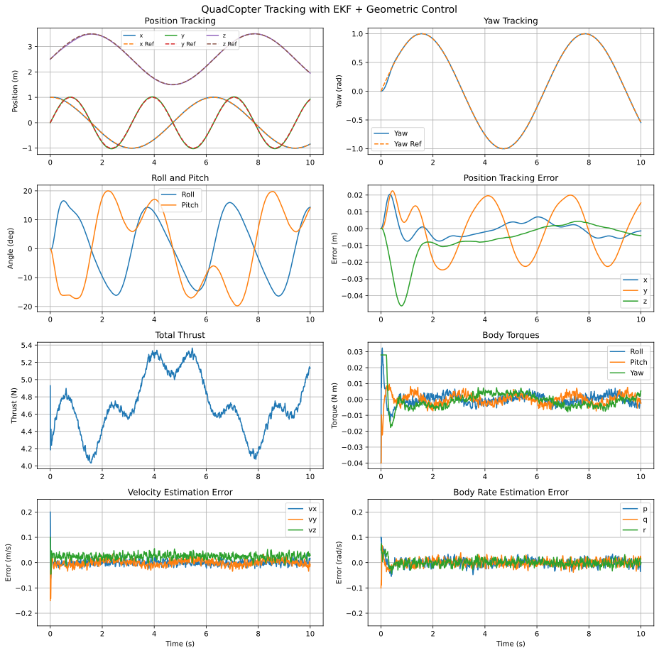
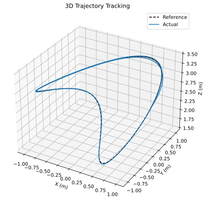
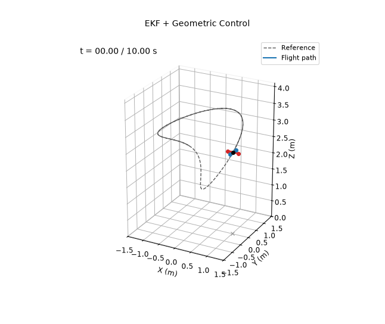

# EKF + Geometric Control

**Controlled variables:** position $`\mathbf p`$ and yaw $`\psi`$, through a geometric tracking controller on SE(3) (Lee, Leok and McClamroch). The attitude error is defined on the rotation group itself rather than on Euler angles.

**Measured outputs:** position $`\mathbf p`$ and Euler angles $`\boldsymbol\eta`$ only, with sensor noise. The controller acts on the estimate from the same extended Kalman filter as demos 7 and 8, with $`\hat R=R(\hat{\boldsymbol\eta})`$ and $`\hat{\boldsymbol\Omega}=\hat{\boldsymbol\omega}`$.

The EKF and the controller both use nominal parameters $`\hat m=0.440`$ kg and $`\hat{\mathbf I}=\mathrm{diag}(0.0021,0.0025,0.0042)`$ kg m², which are 6–9% off the true values. Sensors, noise, initial estimation errors and trajectory are the same as in demos 4 and 6–8.

## Translational Control

With $`\mathbf e_x=\hat{\mathbf p}-\mathbf p_d`$, $`\mathbf e_v=\hat{\mathbf v}-\dot{\mathbf p}_d`$ and the integral $`\boldsymbol\chi`$ of $`\mathbf e_x`$, the desired force is

```math
\mathbf F_d=-k_x\mathbf e_x-k_v\mathbf e_v-k_i\boldsymbol\chi+\hat m\left(\ddot{\mathbf p}_d+g\mathbf e_3\right),
```

with its tilt limited to 30°. The thrust is its projection on the current body axis, $`T=\mathbf F_d\cdot\hat R\mathbf e_3`$.

## Attitude Control on SO(3)

The desired body axis is $`\mathbf b_{3d}=\mathbf F_d/\|\mathbf F_d\|`$. The axis $`\mathbf b_{1d}`$ is chosen perpendicular to $`\mathbf b_{3d}`$ in the vertical plane of the reference heading $`[\cos\psi_d,\sin\psi_d,0]^\top`$, so that the ZYX yaw of $`R_d=[\mathbf b_{1d},\ \mathbf b_{3d}\times\mathbf b_{1d},\ \mathbf b_{3d}]`$ equals $`\psi_d`$. With the flatness-based reference body rates $`\boldsymbol\Omega_d`$ and accelerations $`\dot{\boldsymbol\Omega}_d`$ as feedforward,

```math
\begin{aligned}
\mathbf e_R&=\tfrac12\left(R_d^\top\hat R-\hat R^\top R_d\right)^\vee,\qquad
\mathbf e_\Omega=\hat{\boldsymbol\Omega}-\hat R^\top R_d\boldsymbol\Omega_d,\\
\boldsymbol\tau&=-k_R\mathbf e_R-k_\Omega\mathbf e_\Omega+\hat{\boldsymbol\Omega}\times\hat{\mathbf I}\hat{\boldsymbol\Omega}
-\hat{\mathbf I}\left(\hat{\boldsymbol\Omega}^\wedge\hat R^\top R_d\boldsymbol\Omega_d-\hat R^\top R_d\dot{\boldsymbol\Omega}_d\right).
\end{aligned}
```

The integral is clipped to ±0.5.

| Gain | $`k_x`$ | $`k_v`$ | $`k_i`$ | $`k_R`$ | $`k_\Omega`$ |
|---|---|---|---|---|---|
| $`x`$, $`y`$, $`z`$ | 8 | 2 | 5 | | |
| roll, pitch | | | | 0.3 | 0.03 |
| yaw | | | | 0.6 | 0.06 |

The gains leave margin on $`k_x`$. Tracking degrades smoothly up to $`k_x\approx13`$ and breaks down around $`k_x=15`$, where the attitude loop is no longer fast enough. With a plant 10% heavier than the nominal model, the position RMSE rises to about 0.05 m.

The EKF is the one from demo 7. It runs at 200 Hz on noisy position and Euler angle measurements (1 mm and 0.1° standard deviation), with process noise densities of $`10^{-4}`$ on position and angles and 0.1 on velocity and body rates. It starts with errors of up to 10 cm, 3°, 0.2 m/s and 0.1 rad/s.

The controller gains were tuned by grid search. The search minimized position and yaw error while penalizing thrust and torque chattering, and the chosen gains were checked on five noise seeds.

## Running

From this directory:

```bash
python main.py
```

This prints the metrics below and rewrites the files in `results/`.

## Results

Over the 10 s simulation:

| Metric | Value |
|---|---|
| Position RMSE ($`x`$, $`y`$, $`z`$) | 0.005, 0.015, 0.013 m |
| Total position RMSE | 0.020 m |
| Yaw RMSE | 0.012 rad |
| EKF velocity RMSE ($`t\ge1`$ s) | 0.010, 0.012, 0.027 m/s |
| EKF body rate RMSE ($`t\ge1`$ s) | 0.012, 0.012, 0.011 rad/s |






